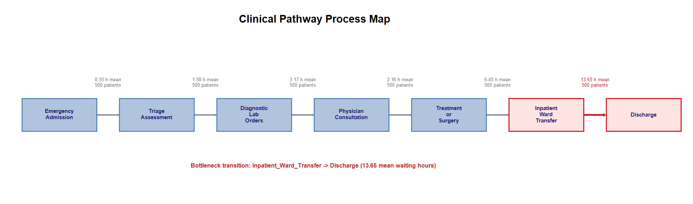
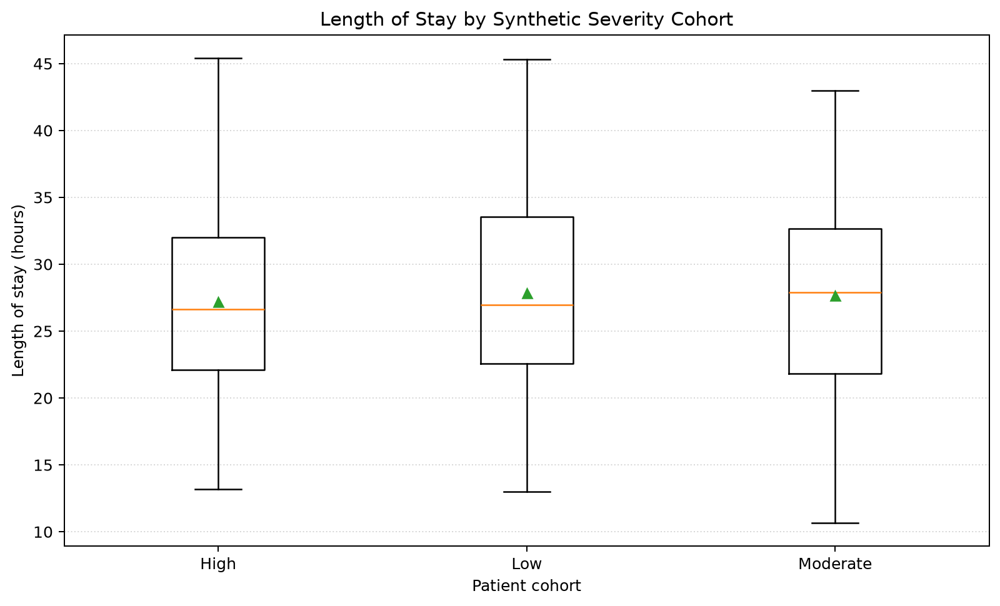
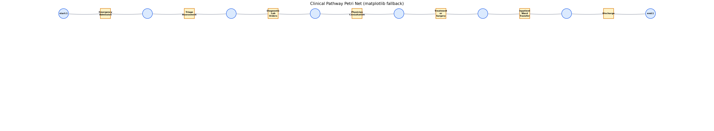
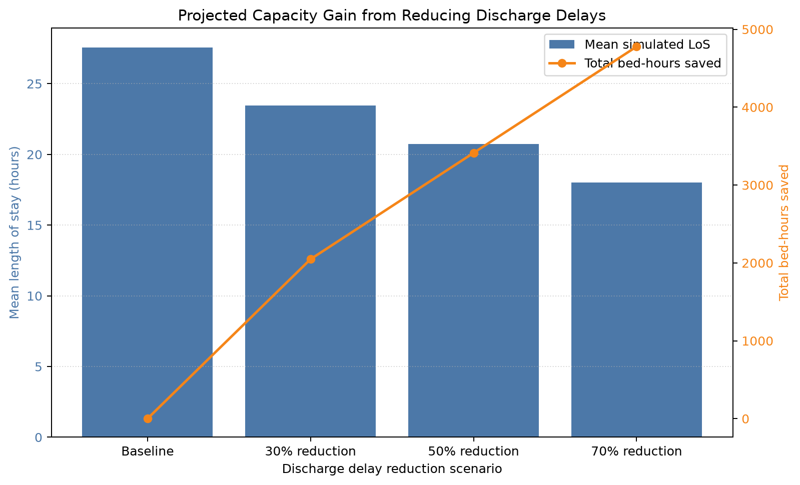
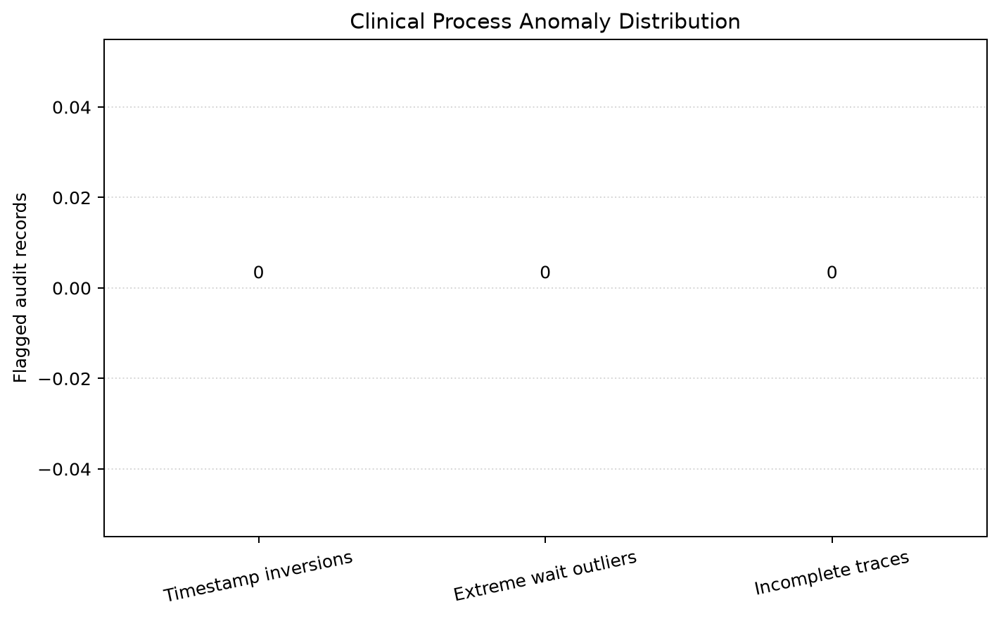

# CareFlow: Clinical Pathway Process Mining

## Slide 1 — Title & Problem Statement

**From patient event logs to operational insight**

- Process-mining demonstration for identifying pathway waits, bottlenecks, and conformance signals.
- Built on 500 synthetic patient cases and 3,500 timestamped events.
- Goal: turn a clinical journey into measurable, reviewable operational questions.

> **Speaker notes:** Frame CareFlow as a reproducible analytics prototype, not a clinical decision-support system. Every result in this deck is synthetic and should be validated against governed operational data before use.

---

## Slide 2 — Dataset & 7 Clinical Milestones

**One event log, seven canonical stages**

1. Emergency Admission
2. Triage Assessment
3. Diagnostic Lab Orders
4. Physician Consultation
5. Treatment or Surgery
6. Inpatient Ward Transfer
7. Discharge

- Each generated case contains a timestamped event for every milestone.
- Department, provider, and severity attributes are synthetic.



> **Speaker notes:** Explain that the fixed seven-stage path makes the current dataset useful for demonstrating the pipeline, but it does not represent the full complexity or exceptions of real clinical care.

---

## Slide 3 — Exploratory Findings & 27.13h LoS

**Baseline length of stay**

- Median admission-to-discharge LoS: **27.13 hours**.
- Mean LoS: **27.56 hours** across 500 cases.
- The transition analysis reports waits for each consecutive milestone.
- These are descriptive synthetic-data results, not a hospital benchmark.



> **Speaker notes:** The cohort chart uses generated severity labels rather than observed clinical acuity. Point out that the plot demonstrates comparison functionality only; it cannot support conclusions about severity and LoS.

---

## Slide 4 — The 13.65h Discharge Bottleneck

**The longest mean wait is the final transition**

- Inpatient Ward Transfer → Discharge: **13.65 hours mean**, **13.51 hours median**.
- Next longest: Treatment or Surgery → Inpatient Ward Transfer at **6.45 hours mean**.
- The process map highlights the discharge transition in red.


> **Speaker notes:** Treat the discharge interval as an investigation hypothesis, not a causal explanation. On validated data, examine discharge readiness, medication reconciliation, transport, placement, and downstream bed constraints.

---

## Slide 5 — pm4py Petri Net & Conformance Audit

**Discover a model; compare traces to a defined reference**

- PM4Py Inductive Miner exports the discovered pathway as PNML.
- Token-based replay: **500 / 500 cases fit** the configured canonical seven-stage path.
- Mean trace fitness: **1.000**.
- This is not conformance validation against an independently approved clinical SOP.



> **Speaker notes:** Explain that 100% fit is expected because the synthetic generator creates the same complete canonical route for every patient. Real SOP conformance requires an approved model and explicit rules for exceptions.

---

## Slide 6 — What-If Capacity Simulation

**Illustrative reduction in transfer-to-discharge delay**

| Scenario | Simulated mean LoS | Mean LoS improvement | Bed-hours saved |
|---|---:|---:|---:|
| 30% reduction | 23.46 h | 4.10 h / case | 2,047.69 |
| **50% reduction** | **20.73 h** | **6.83 h / case** | **3,412.81** |
| 70% reduction | 18.00 h | 9.56 h / case | 4,777.93 |



> **Speaker notes:** The model proportionally shortens the synthetic discharge delay and sums the resulting hours. Bed-hours saved are not a forecast of realized throughput, occupancy, or capacity expansion.

---

## Slide 7 — System Architecture & CI/CD

**Reproducible pipeline from event log to briefing**

```text
Synthetic CSV → validation → transition / variant / SLA analytics
                          → PM4Py discovery and conformance
                          → simulation → executive report
                                      → Streamlit dashboard
```

- `main.py` orchestrates the pipeline; `--skip-viz` supports headless runs.
- Pytest covers event schema, positive transition waits, core analytics, and anomaly checks.
- GitHub Actions runs tests on pushes to `member`.



> **Speaker notes:** Mention that the checked-in anomaly chart currently shows zero findings because the generated source data is clean. The test suite also exercises controlled anomaly examples, including timestamp inversions and incomplete traces.

---

## Slide 8 — Recommendations & Next Steps

**Move from synthetic demonstration to governed validation**

- Validate milestone definitions, timestamps, department ownership, and case completeness with operational stakeholders.
- Reassess the discharge bottleneck using de-identified real event data before selecting an intervention.
- Approve SLA thresholds, exceptions, and denominator reporting; the current breach file is breach-only.
- Compare cohorts only with validated attributes and test conformance against an approved SOP.
- Pilot changes and measure observed LoS, occupancy, and throughput before making capacity claims.

> **Speaker notes:** Close by emphasizing that CareFlow demonstrates an end-to-end technical workflow. The next milestone is data governance and operational validation, not acting on synthetic results as clinical recommendations.
